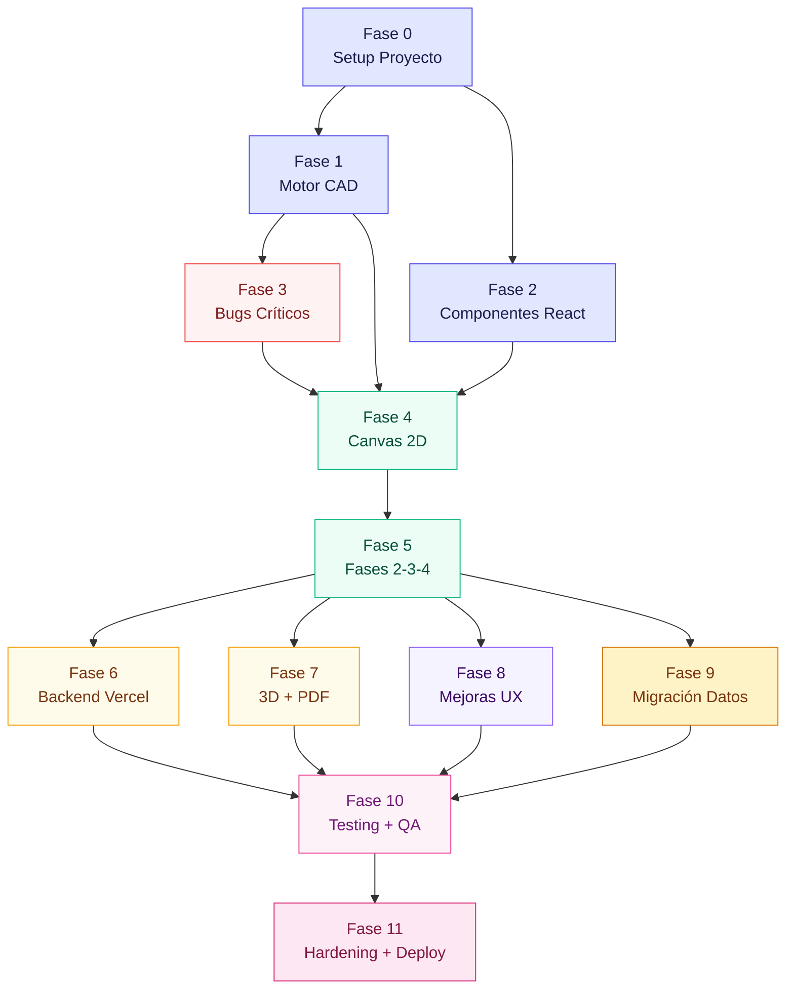

# GATC — Plan de Acciones (Revisión 2)

> **Proyecto:** GATC (Gestor de Análisis para Tendidos y Costos)  
> **Referencia:** [GATC_Analisis_Completo.md](file:///C:/Users/gabri/.gemini/antigravity/brain/5ce9b2b9-a733-4999-a926-a017b5135887/GATC_Analisis_Completo.md)  
> **Fecha:** 20 de noviembre de 2026 — Revisado: 20 de noviembre de 2026  
> **Total de fases:** 12 (Fase 0 a Fase 11)  
> **Estimación total:** ~280–370 horas

---

## Convenciones

- ✅ = Completada  
- 🔄 = En progreso  
- ⬜ = Pendiente  
- 🔴 = Bloqueada  

**Prioridad:** 🟥 Crítica · 🟧 Alta · 🟨 Media · 🟩 Baja

---

## Fase 0 — Inicialización del Proyecto

> **Objetivo:** Crear la base del proyecto Next.js con todas las dependencias y configuraciones necesarias.  
> **Duración estimada:** 6–8 horas  
> **Dependencias:** Ninguna

| ID | Tarea | Prioridad | Estado |
|------|------|------|------|
| F0-01 | Inicializar proyecto Next.js 14 con App Router y TypeScript (`npx create-next-app@latest gatc --typescript --tailwind --app --src-dir`) | 🟥 | ✅ |
| F0-02 | Instalar dependencias core: `zustand`, `immer`, `three`, `@react-three/fiber`, `@react-three/drei`, `jspdf`, `next-auth` | 🟥 | ✅ |
| F0-03 | Configurar `tailwind.config.ts` con la paleta de colores del sistema de diseño (indigo, purple, emerald, amber, slate) | 🟧 | ✅ |
| F0-04 | Crear estructura de carpetas completa (`src/engine/`, `src/stores/`, `src/hooks/`, `src/components/`, `src/lib/`) | 🟥 | ✅ |
| F0-05 | Configurar `vercel.json`, `tsconfig.json` paths aliases (`@/engine`, `@/stores`, `@/components`) y `next.config.ts` | 🟧 | ✅ |
| F0-06 | Crear `.env.local` con variables placeholder (DATABASE_URL, NEXTAUTH_SECRET, etc.) y `.env.example`. Añadir `.env.local` a `.gitignore` | 🟧 | ✅ |
| F0-07 | Configurar ESLint + Prettier con reglas estrictas de TypeScript. Añadir `lint-staged` + `husky` para pre-commit hooks | 🟨 | ✅ |
| F0-08 | Configurar `src/app/globals.css` — Importar fuente Inter desde Google Fonts, scrollbar custom, transiciones base, CSS variables del sistema de diseño | 🟨 | ✅ |
| F0-09 | Inicializar repositorio Git. Crear `.gitignore` completo (node_modules, .next, .env.local, .vercel). Primer commit con estructura vacía | 🟥 | ✅ |

> [!TIP]
> No instalar las dependencias de base de datos aún (Vercel Postgres, KV, Blob). Se agregarán en la Fase 6 cuando se implemente el backend.

---

## Fase 1 — Motor CAD: Tipos y Lógica Pura

> **Objetivo:** Extraer toda la lógica de negocio del HTML monolítico a módulos TypeScript puros, sin dependencia de UI.  
> **Duración estimada:** 16–22 horas  
> **Dependencias:** Fase 0 completa

| ID | Tarea | Prioridad | Estado |
|------|------|------|------|
| F1-01 | Crear `src/engine/types.ts` — Definir todos los tipos: `Wall`, `Box`, `Tube`, `Route`, `Cable`, `ProjectState`, `ProjectConfig`, `Phase`, `ToolType`, `BoxType`, `DeviceKey` | 🟥 | ✅ |
| F1-02 | Crear `src/engine/catalog.ts` — Migrar el objeto `CATALOG` completo con tipado estricto (`Record<DeviceKey, DeviceSpec>`) y los defaults de precios | 🟥 | ✅ |
| F1-03 | Crear `src/engine/geometry.ts` — Migrar funciones puras: `snapToWall`, `getClosestWall`, `pointNearSegment`, `getTubeAtCurve`, `getRoomCenter`, `getWallPolygon` (miter join), `getWorldCoords` | 🟥 | ✅ |
| F1-04 | Crear `src/engine/bom.ts` — Extraer todo el cálculo de BOM/cotización: conteo de materiales, longitud de cables con extras (+0.20m terminal, +0.10m paso), tubería PVC, redondeo ceiling | 🟧 | ✅ |
| F1-05 | Crear `src/engine/symbols.ts` — Migrar la función `drawSymbol()` como función pura que recibe `CanvasRenderingContext2D` y dibuja la simbología eléctrica de cada dispositivo | 🟧 | ✅ |
| F1-06 | Crear `src/utils/math.ts` — Funciones auxiliares: `distance()`, `clamp()`, `snapToGrid()`, `degreesToRadians()`, `generateId()` (usando `crypto.randomUUID()`) | 🟨 | ✅ |
| F1-07 | Crear `src/engine/constants.ts` — Constantes globales: `SCALE = 40`, `SNAP_DISTANCE = 15`, `GRID_SIZE = 20`, `MAX_HISTORY = 50`, `DEFAULT_WALL_WIDTH = 0.20`, `DEFAULT_WALL_HEIGHT = 2.80`, precios default por dispositivo | 🟨 | ✅ |

**Criterio de aceptación:** Cada módulo se puede importar de forma independiente sin errores de TypeScript. Los tipos cubren el 100% de la estructura del estado actual de GATC v1.5.

---

## Fase 2 — Componentes React Base

> **Objetivo:** Crear la estructura visual de la aplicación en React con componentes funcionales. Sin lógica de canvas aún.  
> **Duración estimada:** 18–24 horas  
> **Dependencias:** Fase 0 completa (Fase 1 en paralelo)

| ID | Tarea | Prioridad | Estado |
|------|------|------|------|
| F2-01 | Crear componentes UI reutilizables en `src/components/ui/`: `Button`, `Modal`, `Toast`, `Input`, `Select`, `Tooltip`, `ConfirmDialog` (reemplazar `confirm()` / `alert()` nativos) | 🟧 | ✅ |
| F2-02 | Crear `src/app/page.tsx` — Pantalla de inicio con `ProjectGrid` y `ProjectCard`, efecto linterna con CSS, botón de importar `.gatc` | 🟧 | ✅ |
| F2-03 | Crear `src/app/editor/[projectId]/page.tsx` — Layout del editor con `Header`, `PhaseTabs`, `Toolbar`, `Canvas2D` (placeholder), `PropertiesPanel` | 🟧 | ✅ |
| F2-04 | Crear `src/components/editor/Header.tsx` — Nombre del proyecto editable, botones undo/redo, controles de cotas/reglas, selector de nivel, botones 3D y exportar | 🟨 | ✅ |
| F2-05 | Crear `src/components/editor/Toolbar.tsx` — Barra lateral (desktop) / barra inferior (mobile) con herramientas dinámicas según la fase activa. Implementar con Strategy Pattern | 🟧 | ✅ |
| F2-06 | Crear `src/components/editor/PropertiesPanel.tsx` — Panel lateral (desktop) / bottom sheet (mobile) con propiedades del elemento seleccionado. Responsive con `mobile-bottom-sheet` | 🟨 | ✅ |

**Criterio de aceptación:** La app navega correctamente entre pantalla de inicio y editor. Los componentes renderizan con estilos correctos en desktop y mobile. El canvas está vacío pero el layout funciona.

---

## Fase 3 — Corrección de Bugs Críticos

> **Objetivo:** Resolver todos los bugs de seguridad y estabilidad del análisis antes de continuar con funcionalidades.  
> **Duración estimada:** 10–14 horas  
> **Dependencias:** Fase 1 (tipos definidos)

| ID | Tarea | Prioridad | Ref Bug | Estado |
|------|------|------|------|------|
| F3-01 | Crear `src/utils/sanitize.ts` — Función de escape HTML para prevenir XSS en nombres de proyecto y etiquetas de dispositivos | 🟥 | BUG-01, BUG-02 | ✅ |
| F3-02 | Implementar try/catch en todas las operaciones de localStorage con notificación al usuario cuando la cuota se exceda | 🟥 | BUG-03 | ✅ |
| F3-03 | Cambiar selección por referencia a selección por ID: `selectedId: string | null` en el store, buscar el objeto fresco en cada render | 🟥 | BUG-04 | ✅ |
| F3-04 | Implementar disposición correcta de geometrías y materiales en el toggle 3D (recorrer `scene.traverse()` y hacer `.dispose()`) | 🟥 | BUG-05 | ✅ |
| F3-05 | Reemplazar `setTimeout(300)` en exportación PDF por `requestAnimationFrame` + `Promise` para esperar el render del DOM | 🟧 | BUG-06 | ✅ |
| F3-06 | Crear `src/lib/validators.ts` — Validación completa de archivos `.gatc` importados con schema (verificar `walls`, `boxes`, `tubes`, `routes`, `levels` con tipos correctos) | 🟧 | BUG-10 | ✅ |
| F3-07 | Reemplazar `Math.random().toString(36)` por `crypto.randomUUID()` en `generateId()` | 🟨 | BUG-09 | ✅ |
| F3-08 | Corregir selector CSS inválido `'tfoot text:last-child'` en la exportación PDF — eliminar selector muerto | 🟨 | BUG-07 | ✅ |
| F3-09 | Corregir protección de división por cero en `getRoomCenter` — reemplazar `+0.001` por verificación explícita de paredes horizontales/verticales | 🟨 | BUG-08 | ✅ |
| F3-10 | Implementar distinción tap vs drag en touch events: usar umbral de distancia mínima (5px) y tiempo (200ms) para diferenciar selección de arrastre | 🟧 | BUG-11 | ✅ |

**Criterio de aceptación:** Ningún input del usuario se inyecta como HTML crudo. La app no crashea al llenar localStorage. El visor 3D no pierde memoria tras múltiples toggles. Todos los bugs del análisis (BUG-01 a BUG-11) están resueltos.

---

## Fase 4 — Canvas 2D y Herramientas de Dibujo

> **Objetivo:** Implementar el motor de renderizado 2D en canvas y todas las herramientas de la Fase 1 (Obra Civil).  
> **Duración estimada:** 30–40 horas  
> **Dependencias:** Fase 1 + Fase 2 + Fase 3

| ID | Tarea | Prioridad | Estado |
|------|------|------|------|
| F4-01 | Crear `src/stores/editor-store.ts` — Store Zustand para estado del editor: `tool`, `phase`, `zoom`, `camera`, `selectedId`, `isDragging`, `drawTmp`, `wireRoute`. Usar Immer para inmutabilidad | 🟥 | ✅ |
| F4-02 | Crear `src/stores/project-store.ts` — Store Zustand para estado del proyecto: `walls`, `boxes`, `tubes`, `routes`, `levels`, `config`. Incluir acciones: `addWall`, `addBox`, `moveElement`, `deleteElement` | 🟥 | ✅ |
| F4-03 | Crear `src/engine/renderer2d.ts` — Función principal `render(ctx, state, env, phase)` que dibuja: grid, paredes (con miter), puertas/ventanas/escaleras, cajas, tuberías, cotas, selección, nodos. Migrar todo el `render()` actual | 🟥 | ✅ |
| F4-04 | Crear `src/engine/input-handler.ts` — Gestión unificada de eventos mouse/touch: `handleDown`, `handleMove`, `handleUp`, pinch-to-zoom, wheel zoom, pan. State Machine para herramientas (select, pan, wall, door, window, stairs, box_*, tube) | 🟥 | ✅ |
| F4-05 | Crear `src/hooks/useCanvas.ts` — Hook React que conecta el canvas HTML con el renderer y el input handler. Maneja resize, requestAnimationFrame loop, y pasa el state reactivo al motor | 🟧 | ✅ |
| F4-06 | Crear `src/hooks/useHistory.ts` — Hook para undo/redo con Command Pattern: `pushCommand(cmd)`, `undo()`, `redo()`, `canUndo`, `canRedo`. Máximo 50 estados (mejora sobre los 20 actuales) | 🟧 | ✅ |
| F4-07 | Implementar gestión de niveles completa: `addLevel()`, `deleteLevel()` (con limpieza de walls/boxes/tubes del nivel), `changeLevel()`, sincronización del selector desktop y mobile | 🟧 | ✅ |
| F4-08 | Implementar rulers (reglas) opcionales — Renderizar escalímetro en bordes superior e izquierdo del canvas con marcas cada metro y etiquetas de distancia | 🟨 | ✅ |
| F4-09 | Implementar ghost render del nivel inferior — Cuando `level > 1`, dibujar las paredes y elementos del nivel anterior en 15% de opacidad como referencia | 🟨 | ✅ |

**Criterio de aceptación:** Se pueden dibujar paredes, insertar puertas/ventanas/escaleras/cajas, seleccionar y mover elementos, hacer zoom/pan, y deshacer/rehacer. Las cotas se muestran correctamente. Se pueden añadir/eliminar/cambiar niveles. Funciona en desktop y mobile.

---

## Fase 5 — Fases 2, 3 y 4 del Editor

> **Objetivo:** Implementar el diseño eléctrico, la cotización automática y la memoria descriptiva.  
> **Duración estimada:** 22–28 horas  
> **Dependencias:** Fase 4 completa

| ID | Tarea | Prioridad | Estado |
|------|------|------|------|
| F5-01 | Implementar Fase 2 en el canvas — Asignación de dispositivos a cajas, renderizado de simbología eléctrica (usar `src/engine/symbols.ts`), etiquetas, herramienta de enrutamiento de cables (`wire` tool) | 🟥 | ✅ |
| F5-02 | Crear `src/components/modals/WireRouteModal.tsx` — Modal para configurar circuitos: nombre del circuito, lista de conductores (tipo, calibre, color), colores recientes. Migrar toda la lógica de `openWireModal`, `renderCableRows`, `saveWireRoute` | 🟧 | ✅ |
| F5-03 | Crear `src/components/phases/QuoteView.tsx` — Vista de Fase 3 con tabla de presupuesto: BOM automático usando `src/engine/bom.ts`, precios editables, materiales custom, total. Reemplazar `innerHTML` por componentes React | 🟧 | ✅ |
| F5-04 | Crear `src/components/phases/MemoryView.tsx` — Vista de Fase 4: condiciones arquitectónicas, condiciones eléctricas, resumen de cajas, circuitos por tablero. Componentes React en lugar de `innerHTML` | 🟨 | ✅ |
| F5-05 | Crear `src/components/modals/PricesModal.tsx` — Modal de precios globales con categorías (conductores, accesorios, tableros, tuberías). Persistir en store separado | 🟨 | ✅ |
| F5-06 | Crear `src/stores/prices-store.ts` — Store Zustand separado para precios globales: carga inicial de defaults del catálogo, persistencia en localStorage, merge con precios por proyecto | 🟨 | ✅ |

**Criterio de aceptación:** Las 4 fases del editor funcionan completas. Se puede asignar un dispositivo a una caja, enrutar cables, ver el presupuesto calculado automáticamente y la memoria descriptiva con datos reales del plano.

---

## Fase 6 — Backend y Persistencia en Vercel

> **Objetivo:** Implementar el backend serverless con base de datos, autenticación y almacenamiento en la nube.  
> **Duración estimada:** 24–30 horas  
> **Dependencias:** Fase 5 completa

| ID | Tarea | Prioridad | Estado |
|------|------|------|------|
| F6-01 | Instalar y configurar `@vercel/postgres`, `@vercel/kv`, `@vercel/blob`. Crear esquema Prisma con tablas `User`, `Project`, `GlobalPrices`, `Export` | 🟥 | ✅ |
| F6-02 | Configurar NextAuth.js v5 con proveedores OAuth (Google, GitHub) y protección de rutas API. Middleware para sesiones | 🟧 | ✅ |
| F6-03 | Crear API Routes CRUD en `src/app/api/projects/`: `GET` (listar), `POST` (crear), `GET [id]` (obtener), `PUT [id]` (actualizar), `DELETE [id]` (eliminar) | 🟥 | ✅ |
| F6-04 | Crear API Route `src/app/api/prices/route.ts` — CRUD de precios globales por usuario | 🟨 | ✅ |
| F6-05 | Implementar `src/lib/storage.ts` — Adapter de almacenamiento dual: guardar primero en IndexedDB local (offline-first), sincronizar con API cuando haya conexión. Cola de sync pendiente | 🟧 | ✅ |
| F6-06 | Crear `src/hooks/useAutoSave.ts` — Auto-guardado con debounce de 2 segundos. Indicador visual de estado: guardado ✅, guardando ⏳, error ❌, offline 📴 | 🟨 | ✅ |

**Criterio de aceptación:** Un usuario puede registrarse, crear proyectos que persistan en la nube, y acceder desde cualquier dispositivo. La app sigue funcionando offline y sincroniza al reconectarse.

---

## Fase 7 — Visor 3D, PDF y Exportación

> **Objetivo:** Implementar la visualización 3D con React Three Fiber y la generación de PDF profesional.  
> **Duración estimada:** 22–28 horas  
> **Dependencias:** Fase 5 completa (Fase 6 en paralelo)

| ID | Tarea | Prioridad | Estado |
|------|------|------|------|
| F7-01 | Crear `src/components/editor/Viewer3D.tsx` — Visor Three.js con React Three Fiber: paredes, puertas, ventanas, escaleras, dispositivos eléctricos, tuberías, cables. Capas togglables. Disposición correcta de recursos al desmontar | 🟧 | ✅ |
| F7-02 | Crear `src/engine/renderer3d.ts` — Funciones para generar meshes 3D desde el estado del proyecto: `createWallMesh`, `createBoxMesh`, `createTubeMesh`, `createCableMesh`. Multi-nivel con offset Y | 🟧 | ✅ |
| F7-03 | Crear `src/lib/pdf-generator.ts` — Clase `PDFGenerator` con métodos: `addArchitecturePage(level)`, `addElectricalPage(level)`, `addQuotePage(bom)`, `addMemoryPage(summary)`, `addNomenclaturePage(devices)`. Render a canvas offscreen en alta resolución (4×) | 🟥 | ✅ |
| F7-04 | Crear API Route `src/app/api/export/pdf/route.ts` — Generación de PDF server-side como alternativa. Almacenar en Vercel Blob y retornar URL de descarga | 🟨 | ✅ |
| F7-05 | Implementar importación/exportación `.gatc` como componentes React: `ImportButton` y función `exportProject()`. Validación completa del archivo al importar (usar `validators.ts`) | 🟧 | ✅ |

**Criterio de aceptación:** El visor 3D renderiza correctamente paredes, elementos y cables sin fugas de memoria. El PDF generado incluye todas las secciones seleccionadas con la misma calidad que la versión actual o mejor.

---

## Fase 8 — Mejoras de UX

> **Objetivo:** Implementar todas las mejoras de experiencia de usuario identificadas en el análisis.  
> **Duración estimada:** 20–26 horas  
> **Dependencias:** Fase 5 completa

| ID | Tarea | Prioridad | Estado |
|------|------|------|------|
| F8-01 | Crear `src/hooks/useKeyboard.ts` — Atajos de teclado: `V` (seleccionar), `W` (pared), `D` (puerta), `Ctrl+Z` (undo), `Del` (eliminar), `1-4` (fases), `Space+drag` (pan temporal), `Esc` (cancelar). Mostrar shortcut en tooltip de cada herramienta | 🟧 | ✅ |
| F8-02 | Crear componente `StatusBar.tsx` — Barra inferior con: estado de guardado, zoom con +/−/fit, escala, coordenadas del cursor en metros, herramienta activa, nivel actual | 🟨 | ✅ |
| F8-03 | Crear componente `Minimap.tsx` — Mini-mapa en esquina del canvas: vista miniatura del plano completo, rectángulo de viewport, click para navegar | 🟨 | ✅ |
| F8-04 | Crear componente `CommandPalette.tsx` — Paleta de comandos activada con `Ctrl+K`: búsqueda de acciones (cambiar herramienta, ir a fase, exportar, zoom to fit, etc.) | 🟩 | ✅ |
| F8-05 | Crear componente `OnboardingTour.tsx` — Tour de primera vez (5 pasos): bienvenida, herramientas, fases, 3D, exportar. Se muestra solo una vez (flag en localStorage). Botón "Skip" | 🟩 | ✅ |
| F8-06 | Implementar copiar/pegar elementos: `Ctrl+C` copia selección al clipboard interno, `Ctrl+V` pega en posición del cursor con offset de 20px. Soportar paredes, cajas y grupos | 🟨 | ✅ |
| F8-07 | Implementar `zoomToFit()` — Calcular bounding box de todos los elementos del nivel activo y ajustar camX, camY y zoom para que todo el plano sea visible. Atajo `Ctrl+0` | 🟧 | ✅ |
| F8-08 | Implementar modo oscuro en el editor — Toggle light/dark que cambia fondo del canvas, colores de paredes, panel de propiedades y toolbar. Respetar `prefers-color-scheme` del sistema | 🟩 | ✅ |
| F8-09 | Implementar capas 2D togglables — Checkboxes para mostrar/ocultar tipos de elementos en el canvas (paredes, puertas/ventanas, cajas, tuberías, cotas, etiquetas) | 🟨 | ✅ |

**Criterio de aceptación:** Los atajos de teclado funcionan correctamente sin interferir entre sí. La status bar muestra información en tiempo real. El tour se muestra solo la primera vez. Zoom to fit centra correctamente el plano.

---

## Fase 9 — Migración de Datos y Compatibilidad

> **Objetivo:** Garantizar que los usuarios existentes de GATC v1.5 puedan migrar sus proyectos al nuevo sistema sin perder datos.  
> **Duración estimada:** 10–14 horas  
> **Dependencias:** Fase 5 completa

| ID | Tarea | Prioridad | Estado |
|------|------|------|------|
| F9-01 | Crear `src/lib/migration.ts` — Migrador de datos v1.5 → v2: leer `ecad_projects_index`, `ecad_data_*` y `ecad_global_prices` de localStorage, transformar al nuevo esquema TypeScript, importar a IndexedDB/API | 🟥 | ✅ |
| F9-02 | Implementar detector automático de datos legacy — Al abrir la app, verificar si existen claves `ecad_*` en localStorage. Si existen, mostrar modal de migración con opción de importar o ignorar | 🟧 | ✅ |
| F9-03 | Crear `src/lib/schema-version.ts` — Versionado de esquema de datos con número de versión en cada proyecto guardado. Sistema de migraciones incrementales (v1 → v2 → v3...) para futuros cambios de estructura | 🟧 | ✅ |
| F9-04 | Implementar importación de archivos `.gatc` legacy — Aceptar tanto el formato v1.5 (actual) como el nuevo formato v2, detectando automáticamente la versión | 🟨 | ✅ |

**Criterio de aceptación:** Un usuario que tiene proyectos en GATC v1.5 (localStorage) puede abrir la nueva app y migrar todos sus proyectos con un click. Los datos migrados son 100% funcionales en el nuevo editor.

---

## Fase 10 — Testing, PWA y QA

> **Objetivo:** Asegurar la calidad del código, habilitar funcionalidad offline y validar toda la app.  
> **Duración estimada:** 20–26 horas  
> **Dependencias:** Fases 6, 7, 8 y 9 completas

| ID | Tarea | Prioridad | Estado |
|------|------|------|------|
| F10-01 | Configurar Vitest + Testing Library. Escribir tests unitarios para `src/engine/`: `geometry.test.ts` (snap, miter, intersección), `bom.test.ts` (cálculo de materiales), `catalog.test.ts` (validar catálogo completo) | 🟧 | ✅ |
| F10-02 | Configurar Playwright. Escribir tests E2E: crear proyecto, dibujar pared, insertar puerta, asignar dispositivo, enrutar cable, verificar presupuesto, exportar PDF | 🟧 | ✅ |
| F10-03 | Implementar PWA con `next-pwa` o `Serwist`: `manifest.json`, Service Worker con cache de assets, funcionalidad offline completa del editor | 🟧 | ✅ |
| F10-04 | Auditoría de accesibilidad: eliminar `user-scalable=no`, añadir `aria-label` a todos los botones SVG, verificar contraste WCAG AA, tab focus visible, respetar `prefers-reduced-motion` | 🟥 | ✅ |
| F10-05 | Optimización de rendimiento: lazy loading del visor 3D y PDF generator con `dynamic()`, code splitting por ruta, compresión de assets, análisis de bundle con `@next/bundle-analyzer` | 🟨 | ✅ |
| F10-06 | Testing de migración: probar con datos reales de GATC v1.5 (crear proyecto completo en v1.5, migrar a v2, verificar integridad de walls, boxes, tubes, routes, precios) | 🟧 | ✅ |

**Criterio de aceptación:** Cobertura de tests ≥ 70% en módulos del engine. Tests E2E pasan en CI. Lighthouse score ≥ 90 en Performance, ≥ 95 en Accessibility. La app funciona offline. Migración de datos v1.5 → v2 sin pérdidas.

---

## Fase 11 — Hardening, Seguridad y Deploy

> **Objetivo:** Blindar la aplicación para producción: manejo de errores, seguridad, monitoreo, documentación y despliegue final.  
> **Duración estimada:** 18–24 horas  
> **Dependencias:** Fase 10 completa

| ID | Tarea | Prioridad | Estado |
|------|------|------|------|
| F11-01 | Implementar React Error Boundaries — Componentes `ErrorBoundary` para canvas, visor 3D, paneles de fases. Mostrar UI de fallback con opción de reiniciar el editor sin perder datos | 🟥 | ✅ |
| F11-02 | Implementar loading states y skeletons — Spinner/skeleton al cargar proyecto, loading overlay al generar PDF, skeleton en pantalla de inicio mientras se cargan proyectos | 🟧 | ✅ |
| F11-03 | Configurar rate limiting en API Routes — Limitar a 60 req/min por usuario en endpoints de CRUD, 10 req/min en generación de PDF. Usar Vercel KV para contadores | 🟧 | ✅ |
| F11-04 | Configurar security headers en `next.config.ts` — CSP (Content Security Policy), X-Frame-Options, X-Content-Type-Options, Referrer-Policy, Permissions-Policy | 🟧 | ✅ |
| F11-05 | Configurar monitoreo de errores con Sentry (o Vercel Error Tracking) — Captura automática de errores JS, source maps en producción, alertas por email | 🟨 | ✅ |
| F11-06 | Crear `README.md` del proyecto — Descripción, screenshots, stack tecnológico, instrucciones de setup local, variables de entorno, despliegue, licencia | 🟨 | ✅ |
| F11-07 | Configurar SEO básico — Meta tags (Open Graph, Twitter Cards), favicon, app icons para PWA (192×192, 512×512), `robots.txt`, `sitemap.xml` | 🟨 | ✅ |
| F11-08 | Despliegue a producción en Vercel: configurar dominio, variables de entorno de producción, base de datos de producción, DNS, monitoreo con Vercel Analytics y Speed Insights | 🟥 | ✅ |

**Criterio de aceptación:** La app no muestra errores técnicos al usuario (siempre muestra UI de fallback). Los endpoints API tienen rate limiting. Los headers de seguridad pasan auditoría. El deploy en producción es exitoso con URL pública funcional.

---

## Diagrama de Dependencias entre Fases

---

## Resumen por Fase

| Fase | Nombre | Tareas | Horas Est. | Puede paralelizarse con |
|------|------|------|------|------|
| **0** | Setup Proyecto | 9 | 6–8 | — |
| **1** | Motor CAD (Tipos + Lógica) | 7 | 18–24 | Fase 2 |
| **2** | Componentes React Base | 6 | 18–24 | Fase 1 |
| **3** | Corrección de Bugs | 10 | 14–18 | — |
| **4** | Canvas 2D + Herramientas | 9 | 36–46 | — |
| **5** | Fases 2, 3 y 4 del Editor | 6 | 24–30 | — |
| **6** | Backend Vercel | 6 | 24–30 | Fase 7, 8 y 9 |
| **7** | 3D, PDF, Exportación | 5 | 22–28 | Fase 6, 8 y 9 |
| **8** | Mejoras UX | 9 | 26–34 | Fase 6, 7 y 9 |
| **9** | Migración de Datos | 4 | 10–14 | Fase 6, 7 y 8 |
| **10** | Testing, PWA, QA | 6 | 20–26 | — |
| **11** | Hardening + Deploy | 8 | 18–24 | — |
| | **TOTAL** | **85 tareas** | **~280–370 h** | |

> [!IMPORTANT]
> Las **Fases 6, 7, 8 y 9** son independientes entre sí y pueden trabajarse en paralelo una vez completada la Fase 5. Esto permite reducir el timeline total significativamente si se trabaja en más de un frente.

---

## Checklist de Vacíos Corregidos en Revisión 2

Los siguientes ítems estaban ausentes en la versión inicial del plan y fueron incorporados:

| Vacío detectado | Tarea que lo cubre |
|------|------|
| Sin `.env.local` ni `.gitignore` | F0-06, F0-09 |
| Sin ESLint / Prettier / pre-commit | F0-07 |
| Sin CSS globals (fuentes, scrollbar) | F0-08 |
| Sin constantes globales (`SCALE`, etc.) | F1-07 |
| BUG-07 no corregido (selector inválido) | F3-08 |
| BUG-08 no corregido (división por cero) | F3-09 |
| BUG-11 no corregido (touch tap vs drag) | F3-10 |
| Sin gestión de niveles (add/delete/switch) | F4-07 |
| Sin rulers (reglas) | F4-08 |
| Sin ghost render nivel inferior | F4-09 |
| Sin store de precios globales | F5-06 |
| Sin zoom-to-fit | F8-07 |
| Sin modo oscuro editor | F8-08 |
| Sin capas 2D togglables | F8-09 |
| Sin migración datos v1.5 → v2 | F9-01 a F9-04 (fase nueva) |
| Sin Error Boundaries | F11-01 |
| Sin loading/skeleton states | F11-02 |
| Sin rate limiting API | F11-03 |
| Sin security headers | F11-04 |
| Sin monitoreo de errores (Sentry) | F11-05 |
| Sin README / documentación | F11-06 |
| Sin SEO / favicon / meta tags | F11-07 |
| Deploy separado de testing | F11-08 |
