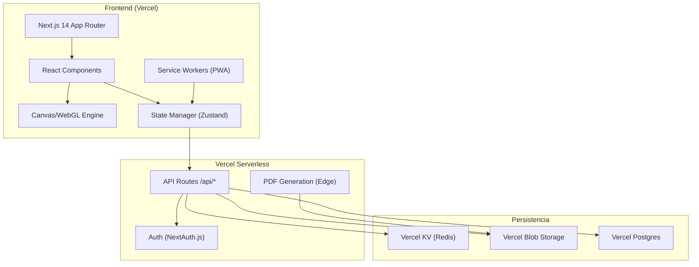
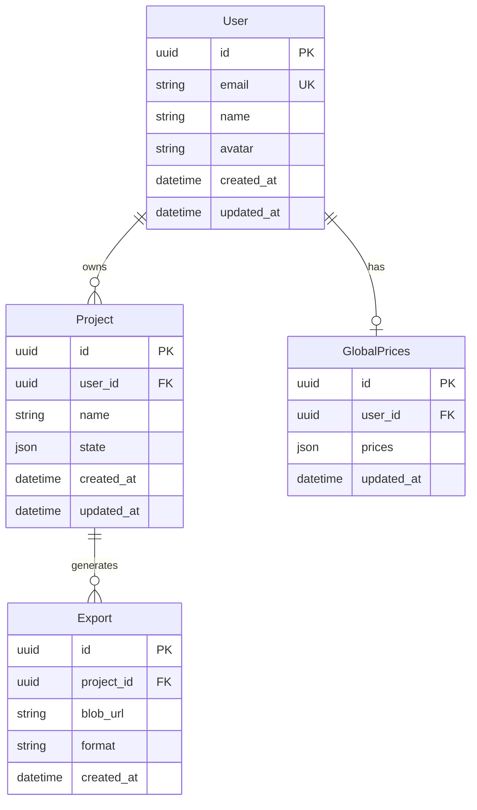
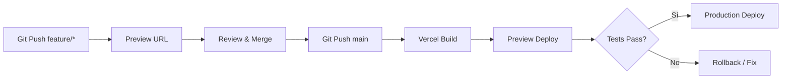
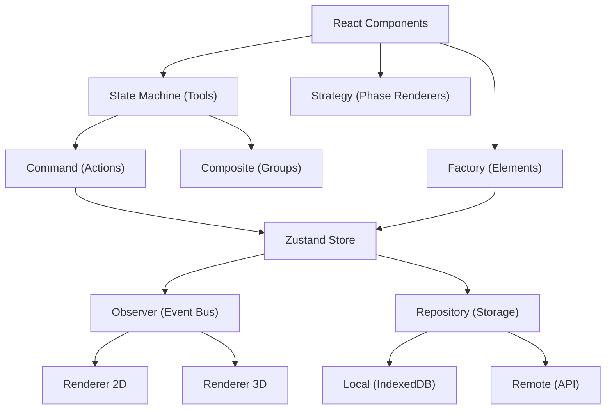
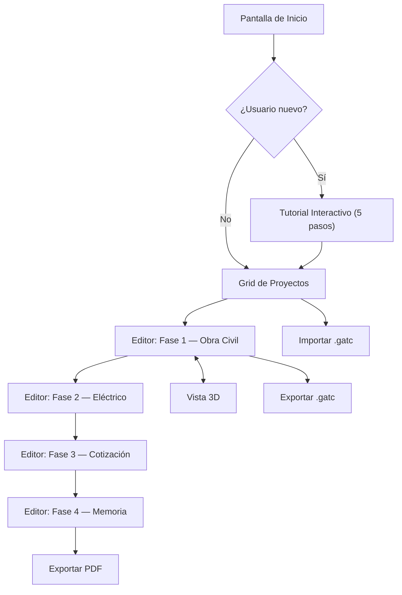

# GATC v1.5 — Análisis Integral del Proyecto

> **Autor del proyecto:** Gabriel  
> **Fecha de análisis:** 20 de noviembre de 2026  
> **Archivo fuente:** [GATCv1.5.html](file:///c:/Users/gabri/OneDrive/Documentos/sex/GATCv1.5.html)  
> **Líneas de código:** ~2,247 líneas (HTML + CSS + JS monolítico)

---

## 1. 📋 Requerimientos y Reglas del Proyecto

### 1.1 Descripción General

**GATC** (Gestor de Análisis para Tendidos y Costos) es una aplicación web CAD para el diseño de instalaciones eléctricas residenciales. Permite crear planos arquitectónicos, diseñar tendidos eléctricos, generar presupuestos automáticos y exportar documentación profesional en PDF.

### 1.2 Requerimientos Funcionales

#### RF-01: Gestión de Proyectos
- Crear, renombrar y eliminar proyectos ilimitados
- Persistencia en `localStorage`
- Importar/exportar archivos `.gatc` (formato JSON)
- Migración automática de proyectos del sistema anterior (slots fijos 1–3)
- Pantalla de inicio con vista de tarjetas y efecto "linterna" con mouse

#### RF-02: Fase 1 — Obra Civil (Dibujo Arquitectónico)
- Dibujo de paredes con nodos snappables (conexión automática en 15px)
- Inserción de puertas, ventanas y escaleras con rotación automática según pared
- Inserción de cajas eléctricas (octagonal, rectangular, cuadrada)
- Miter join automático de paredes conectadas (intersección de polígonos)
- Nodos fijables individualmente (N1, N2) para control paramétrico
- Desacoplar nodos de paredes conectadas
- Bloqueo de edición por elemento
- Crecimiento de pared configurable (centro, hacia L1, hacia L2)
- Cotas de dimensionamiento en ambos lados de cada pared (Lado 1 azul, Lado 2 verde)
- Reglas opcionales (rulers) con escala en metros
- Mover ambiente completo (walls + boxes asociadas como bloque)

#### RF-03: Fase 2 — Diseño Eléctrico
- Asignación de accesorios eléctricos a cajas desde catálogo (20+ dispositivos)
- Simbología eléctrica estándar (NOM/IEC adaptada)
- Enrutamiento de cables entre cajas a través de tuberías existentes
- Circuitos con múltiples conductores (AWG, SPT, TSJ, UTP, Custom)
- Colores de cables con paleta reciente (8 colores)
- Rutas derivadas (split de tubo específico)
- Edición y eliminación de rutas por tubo

#### RF-04: Tubería y Cableado
- Tuberías PVC con tipos: 1/2", 3/4", 1"
- Ubicación configurable: techo, pared (directo), suelo (−0.20m)
- Puntos intermedios de curva (Bézier cuadrática para techo/suelo, línea recta para pared)
- Cálculo automático de longitud considerando recorrido 3D (subida, horizontal, bajada)

#### RF-05: Fase 3 — Cotización (BOM automático)
- Bill of Materials generado automáticamente desde elementos del plano
- Conteo de accesorios eléctricos por tipo
- Cálculo de longitud de cable por conductor con:
  - +0.20m por caja terminal
  - +0.10m por caja de paso/empalme
  - Altura Z de subida/bajada al techo o suelo
- Precios unitarios editables por proyecto y globales
- Redondeo al entero superior (ceiling) para cantidades de cable
- Materiales personalizados (extras/mano de obra)
- Cantidades ajustables manualmente (override del cálculo)
- Moneda: Quetzales (Q)

#### RF-06: Fase 4 — Memoria Descriptiva
- Resumen de condiciones arquitectónicas (ancho pared, altura nivel)
- Resumen de condiciones eléctricas
- Conteo global de cajas por tipo y estado (usadas/vacías)
- Mapa de circuitos enrutados por tablero de distribución
- Longitud total de tubería calculada

#### RF-07: Visualización 3D
- Motor Three.js con OrbitControls
- Renderizado de paredes como BoxGeometry con altura real
- Puertas, ventanas y escaleras en 3D con materiales diferenciados
- Tuberías como TubeGeometry con curvas CatmullRom
- Cables como TubeGeometry con color del conductor
- Capas togglables: Civil, Tubos, Eléctrico, Cables
- Multi-nivel con offset Y por nivel

#### RF-08: Exportación PDF
- Generación con jsPDF
- Planos Arquitectónicos (Fase 1) por nivel
- Planos Eléctricos (Fase 2) por nivel  
- Presupuesto de Materiales con tabla detallada
- Memoria Descriptiva con resumen completo
- Nomenclatura y Simbología con renders de símbolos reales
- Orientación automática (landscape/portrait) según dimensiones del plano
- Render a alta resolución (escala 4×) con export a JPEG 85%
- Marca de agua "GATC" y pie de página con fecha/proyecto

#### RF-09: Configuración Global
- Precios globales persistentes (separados de proyectos)
- Ancho de pared base configurable
- Altura de nivel base configurable
- Catálogo con alturas estándar por dispositivo

#### RF-10: Interacción Multi-dispositivo
- Soporte touch completo: pinch-to-zoom, pan con 2 dedos
- Mouse: scroll wheel para zoom, click derecho/medio para pan
- Snap a grid de 10px para herramientas de dibujo
- Panel de propiedades: lateral (desktop), bottom sheet (mobile)
- Menú mobile hamburguesa con controles condensados

### 1.3 Requerimientos No Funcionales

| ID | Requerimiento | Estado Actual |
|------|------|------|
| RNF-01 | Funcionar 100% client-side sin backend | ✅ Cumple |
| RNF-02 | Responsive (mobile + desktop) | ✅ Cumple |
| RNF-03 | Persistencia sin internet | ✅ localStorage |
| RNF-04 | Rendimiento fluido con 100+ elementos | ⚠️ Sin optimizar |
| RNF-05 | Exportación PDF offline | ✅ jsPDF local |
| RNF-06 | UI moderna y profesional | ✅ Tailwind + diseño custom |

### 1.4 Reglas de Negocio

| Regla | Descripción |
|------|------|
| RN-01 | Las alturas estándar son: Tomacorriente 0.40m, Apagador 1.20m, Tablero 1.75m, Ducha 1.80m |
| RN-02 | El cableado suma +0.20m por punta terminal y +0.10m por caja de paso |
| RN-03 | La tubería por techo recorre: (H_nivel − Z_inicio) + horizontal + (H_nivel − Z_fin) |
| RN-04 | La tubería por suelo recorre: (Z_inicio + 0.20) + horizontal + (Z_fin + 0.20) |
| RN-05 | Los precios son en Quetzales (Q) — mercado guatemalteco |
| RN-06 | Las dimensiones de cajas son: Octagonal ⌀10.16cm, Rectangular 6.35×10.20cm, Cuadrada 10.20×10.20cm |
| RN-07 | La escala del plano es 40 píxeles = 1 metro |
| RN-08 | El historial de deshacer tiene un máximo de 20 estados |
| RN-09 | Los tableros van de 1 a 16 polos |
| RN-10 | Los archivos `.gatc` son JSON plano con validación mínima (walls + boxes requeridos) |

### 1.5 Catálogo de Dispositivos Eléctricos

| Clave | Dispositivo | Símbolo | Altura Z (m) | Precio Base (Q) |
|------|------|------|------|------|
| `light` | Lámpara/Plafón | L (X cruzada) | 2.80 | 45 |
| `wall_lamp` | Lámpara de Pared | W (semicírculo) | 2.00 | 65 |
| `switch_1` | Apagador Sencillo | S | 1.20 | 18 |
| `switch_2` | Apagador Doble | 2S | 1.20 | 25 |
| `switch_3` | Apagador Triple | 3S | 1.20 | 35 |
| `switch_3w` | Apagador 3-Way | S₃w | 1.20 | 22 |
| `switch_3w_dbl` | Apag. Doble 3-Way | 2S₃w | 1.20 | 45 |
| `switch_3w_tpl` | Apag. Triple 3-Way | 3S₃w | 1.20 | 60 |
| `mix_1` | Mixto (Apag + Toma) | M | 1.20 | 35 |
| `mix_3w` | Mixto (3Way + Toma) | M₃w | 1.20 | 40 |
| `outlet_120` | Tomacorriente 120V | T (‖ líneas) | 0.40 | 20 |
| `outlet_240` | Tomacorriente 240V | T₂₄₀ | 0.40 | 45 |
| `shower` | Ducha Eléctrica | D | 1.80 | 250 |
| `heater` | Calentador de Paso | C | 1.50 | 800 |
| `pump` | Bomba de Agua | B | 0.20 | 600 |
| `doorbell` | Timbre | TIM | 2.20 | 80 |
| `push_btn` | Pulsador de Timbre | P | 1.20 | 15 |
| `panel` | Tablero de Distribución | TAB (triángulo) | 1.75 | 850 |
| `meter` | Contador Eléctrico | KWH | 1.70 | 400 |
| `tv` | Toma de TV / Cable | TV | 0.40 | 25 |
| `internet` | Toma de Internet | RJ | 0.40 | 30 |

---

## 2. 🐛 Análisis de Bugs, Errores y Mejoras

### 2.1 Bugs Críticos

#### BUG-01: XSS por inyección en nombres de proyecto
- **Ubicación:** [Líneas 454–475](file:///c:/Users/gabri/OneDrive/Documentos/sex/GATCv1.5.html#L454-L475)
- **Problema:** Se usa `innerHTML` con `proj.name` directamente en templates sin sanitizar. Un nombre de proyecto como `` ejecutaría JS arbitrario.
- **Impacto:** Alto — especialmente al importar archivos `.gatc` de terceros.
- **Fix:** Usar `textContent` o sanitizar con `DOMPurify`.

#### BUG-02: XSS por inyección en etiquetas de dispositivos
- **Ubicación:** [Línea 1309](file:///c:/Users/gabri/OneDrive/Documentos/sex/GATCv1.5.html#L1309)
- **Problema:** `o.label` se inyecta directo en innerHTML del panel de propiedades.
- **Fix:** Escape de HTML antes de insertar.

#### BUG-03: Pérdida de datos en localStorage por cuota excedida
- **Ubicación:** [Líneas 587–592](file:///c:/Users/gabri/OneDrive/Documentos/sex/GATCv1.5.html#L587-L592)
- **Problema:** `save()` no captura la excepción `QuotaExceededError` que lanza localStorage. Si el storage está lleno, se pierde el guardado silenciosamente o crashea.
- **Fix:** Envolver en try/catch con notificación al usuario.

#### BUG-04: `selectedObj` como referencia mutable no protegida
- **Ubicación:** [Línea 1192](file:///c:/Users/gabri/OneDrive/Documentos/sex/GATCv1.5.html#L1192)
- **Problema:** `this.state.selectedObj = o` almacena referencia directa. Si el objeto se elimina de walls/boxes pero selectedObj sigue apuntando a él, se producen NPE en renderProp.
- **Fix:** Usar ID como selección y buscar el objeto fresco en cada render.

#### BUG-05: Fuga de memoria en 3D
- **Ubicación:** [Línea 1831](file:///c:/Users/gabri/OneDrive/Documentos/sex/GATCv1.5.html#L1831)
- **Problema:** `toggle3D()` llama `this.refs.ren.dispose()` y limpia el container, pero no dispone las geometrías y materiales individuales de la escena. Cada toggle crea nuevos `Mesh`, `Material` y `Geometry` sin liberar los anteriores.
- **Fix:** Recorrer `scene.children` y hacer `geometry.dispose()` + `material.dispose()` antes de limpiar.

#### BUG-06: Race condition en exportación PDF
- **Ubicación:** [Líneas 2135–2238](file:///c:/Users/gabri/OneDrive/Documentos/sex/GATCv1.5.html#L2135-L2238)
- **Problema:** Se usa `setTimeout(..., 300)` para esperar que el DOM del presupuesto se renderice antes de leerlo. Es un timing arbitrario que puede fallar en dispositivos lentos.
- **Fix:** Usar `requestAnimationFrame` o `MutationObserver`.

#### BUG-07: `tfoot text:last-child` selector inválido en PDF
- **Ubicación:** [Línea 2154](file:///c:/Users/gabri/OneDrive/Documentos/sex/GATCv1.5.html#L2154)
- **Problema:** `document.querySelector('tfoot text:last-child')` — `text` no es un elemento HTML válido; debería ser `tfoot td:last-child`. El fallback funciona, pero el primer selector nunca matcheará.
- **Fix:** Eliminar `tfoot text:last-child`.

### 2.2 Bugs Medios

#### BUG-08: División por cero en cálculo de intersección de paredes
- **Ubicación:** [Líneas 785–789](file:///c:/Users/gabri/OneDrive/Documentos/sex/GATCv1.5.html#L785-L789)
- **Problema:** `getRoomCenter` usa `0.001` como divisor de protección, pero si una pared tiene `y1 === y2`, la fórmula de intersección `(w.y2-w.y1+0.001)` puede dar resultados incorrectos en paredes horizontales muy largas.

#### BUG-09: Duplicación de IDs potencial
- **Ubicación:** [Línea 410](file:///c:/Users/gabri/OneDrive/Documentos/sex/GATCv1.5.html#L410)
- **Problema:** `genId()` usa `Math.random().toString(36).substr(2, 9)` — 9 caracteres base-36 = ~4.7 × 10¹³ combinaciones. Baja probabilidad pero posible con muchos proyectos.
- **Fix:** Usar `crypto.randomUUID()`.

#### BUG-10: Importación de archivo `.gatc` no valida la estructura completa
- **Ubicación:** [Líneas 532–534](file:///c:/Users/gabri/OneDrive/Documentos/sex/GATCv1.5.html#L532-L534)
- **Problema:** Solo verifica `data.walls` y `data.boxes`. No valida que tubes, routes, levels existan con la estructura correcta. Un archivo malformado puede crashear la app.

#### BUG-11: Touch event handler no diferencia entre tap y drag
- **Ubicación:** [Líneas 1138–1188](file:///c:/Users/gabri/OneDrive/Documentos/sex/GATCv1.5.html#L1138-L1188)
- **Problema:** `touchstart` con `preventDefault()` impide el scroll nativo y puede bloquear zoom del navegador fuera del canvas.

### 2.3 Mejoras Sugeridas

#### MEJ-01: Separar la app monolítica en módulos
La app tiene ~2250 líneas en un solo archivo. Separarla en módulos ES es fundamental para mantenibilidad.

#### MEJ-02: Usar `crypto.randomUUID()` para IDs
Reemplazar `Math.random().toString(36)` por `crypto.randomUUID()` para IDs determinísticamente únicos.

#### MEJ-03: Implementar auto-guardado con debounce
Actualmente se guarda en cada `pushHistory()`. Usar debounce de 500ms para evitar escrituras excesivas.

#### MEJ-04: Añadir soporte para múltiples usuarios/proyectos compartidos
Implementar backend con base de datos para colaboración.

#### MEJ-05: Reemplazar `confirm()` y `alert()` por modales custom
Los diálogos nativos del navegador rompen la experiencia visual moderna.

#### MEJ-06: Implementar undo/redo con Command Pattern
Actualmente se serializa todo el estado en cada push. Con Command Pattern se serializa solo el delta (más eficiente).

#### MEJ-07: Añadir soporte para copiar/pegar elementos
No existe funcionalidad de clipboard para duplicar paredes, cajas o grupos.

#### MEJ-08: Implementar layers/capas visibles independientes
Poder ocultar/mostrar tipos de elementos en el canvas 2D.

#### MEJ-09: Añadir atajos de teclado (keyboard shortcuts)
No hay shortcuts para herramientas, undo, zoom, etc.

#### MEJ-10: Mejorar el cálculo de BOM para tuberías
Actualmente no se contabiliza la longitud total de tubería PVC en el presupuesto, solo se cuentan cables.

#### MEJ-11: Añadir exportación DXF/DWG
Para compatibilidad con AutoCAD.

#### MEJ-12: Implementar zoom a selección (zoom to fit)
No hay función de centrar la vista automáticamente en el contenido.

#### MEJ-13: Protección contra datos obsoletos en IndexedDB/localStorage
Implementar versionado de esquema para manejar migraciones futuras.

---

## 3. 🏗️ Arquitectura para Despliegue en Vercel

### 3.1 Arquitectura Propuesta



### 3.2 Stack Tecnológico

| Capa | Tecnología | Justificación |
|------|------|------|
| **Framework** | Next.js 14 (App Router) | SSR, API routes, optimizado para Vercel |
| **Lenguaje** | TypeScript | Tipo-seguro para un proyecto CAD complejo |
| **UI Framework** | React 18 + Tailwind CSS v4 | Componentes reactivos + utilidades CSS |
| **Canvas Engine** | Konva.js / Custom Canvas API | Rendimiento y control fino para CAD |
| **3D Engine** | Three.js (React Three Fiber) | Integración React con Three.js |
| **Estado** | Zustand + Immer | Estado inmutable sin boilerplate |
| **Auth** | NextAuth.js v5 | OAuth social + credenciales |
| **Base de Datos** | Vercel Postgres (Neon) | Proyectos, usuarios, precios |
| **Cache** | Vercel KV (Redis) | Sesiones, estado temporal |
| **Archivos** | Vercel Blob | Almacenamiento de exportaciones PDF |
| **PDF** | @react-pdf/renderer o jsPDF | Generación server-side |
| **PWA** | next-pwa / Serwist | Funcionalidad offline |
| **Testing** | Vitest + Playwright | Unit + E2E |

### 3.3 Estructura de Carpetas

```
gatc/
├── src/
│   ├── app/                          # Next.js App Router
│   │   ├── layout.tsx                # Layout raíz
│   │   ├── page.tsx                  # Pantalla de inicio (proyectos)
│   │   ├── editor/
│   │   │   └── [projectId]/
│   │   │       └── page.tsx          # Editor CAD principal
│   │   ├── api/
│   │   │   ├── projects/
│   │   │   │   ├── route.ts          # CRUD proyectos
│   │   │   │   └── [id]/route.ts     # Proyecto específico
│   │   │   ├── export/
│   │   │   │   └── pdf/route.ts      # Generación PDF server-side
│   │   │   ├── auth/[...nextauth]/
│   │   │   │   └── route.ts          # Autenticación
│   │   │   └── prices/
│   │   │       └── route.ts          # Precios globales
│   │   └── globals.css
│   │
│   ├── components/
│   │   ├── editor/
│   │   │   ├── Canvas2D.tsx          # Motor de renderizado 2D
│   │   │   ├── Viewer3D.tsx          # Visor Three.js
│   │   │   ├── Toolbar.tsx           # Barra de herramientas por fase
│   │   │   ├── PropertiesPanel.tsx   # Panel de propiedades lateral
│   │   │   ├── PhaseTabs.tsx         # Tabs de fases
│   │   │   ├── LevelSelector.tsx     # Selector de niveles
│   │   │   └── Header.tsx            # Header del editor
│   │   ├── modals/
│   │   │   ├── WireRouteModal.tsx    # Modal de enrutamiento
│   │   │   ├── PricesModal.tsx       # Modal de precios
│   │   │   └── ExportModal.tsx       # Modal de exportación
│   │   ├── phases/
│   │   │   ├── QuoteView.tsx         # Vista Fase 3 (Cotización)
│   │   │   └── MemoryView.tsx        # Vista Fase 4 (Memoria)
│   │   ├── projects/
│   │   │   ├── ProjectCard.tsx       # Tarjeta de proyecto
│   │   │   └── ProjectGrid.tsx       # Grid de proyectos
│   │   └── ui/                       # Componentes reutilizables
│   │       ├── Button.tsx
│   │       ├── Modal.tsx
│   │       ├── Toast.tsx
│   │       └── Input.tsx
│   │
│   ├── engine/                       # Motor CAD (separado de React)
│   │   ├── types.ts                  # Tipos: Wall, Box, Tube, Route
│   │   ├── catalog.ts               # Catálogo de dispositivos
│   │   ├── geometry.ts              # Cálculos: snap, miter, intersección
│   │   ├── renderer2d.ts            # Renderizado canvas 2D
│   │   ├── renderer3d.ts            # Setup Three.js
│   │   ├── symbols.ts              # Dibujo de simbología eléctrica
│   │   ├── bom.ts                   # Cálculo de BOM/cotización
│   │   └── input-handler.ts        # Gestión de mouse/touch events
│   │
│   ├── stores/
│   │   ├── project-store.ts         # Estado del proyecto (Zustand)
│   │   ├── editor-store.ts          # Estado del editor (UI/env)
│   │   └── prices-store.ts          # Precios globales
│   │
│   ├── hooks/
│   │   ├── useCanvas.ts             # Hook para canvas 2D
│   │   ├── useHistory.ts            # Hook para undo/redo
│   │   ├── useKeyboard.ts           # Atajos de teclado
│   │   └── useAutoSave.ts           # Auto-guardado con debounce
│   │
│   ├── lib/
│   │   ├── db.ts                    # Cliente Vercel Postgres
│   │   ├── storage.ts               # Cliente Vercel Blob
│   │   ├── pdf-generator.ts         # Generación PDF
│   │   └── validators.ts            # Validación de datos
│   │
│   └── utils/
│       ├── math.ts                  # Funciones matemáticas
│       ├── colors.ts                # Gestión de colores
│       └── sanitize.ts              # Sanitización HTML
│
├── public/
│   ├── icons/                        # Iconos PWA
│   └── manifest.json                 # PWA manifest
│
├── prisma/
│   └── schema.prisma                 # Esquema de base de datos
│
├── tests/
│   ├── unit/                         # Tests unitarios
│   └── e2e/                          # Tests E2E
│
├── next.config.ts
├── tailwind.config.ts
├── tsconfig.json
├── vercel.json
└── package.json
```

### 3.4 Esquema de Base de Datos



### 3.5 Configuración de Vercel

```json
// vercel.json
{
  "framework": "nextjs",
  "regions": ["iad1"],
  "functions": {
    "src/app/api/export/pdf/route.ts": {
      "maxDuration": 30,
      "memory": 1024
    }
  },
  "headers": [
    {
      "source": "/editor/(.*)",
      "headers": [
        { "key": "Cross-Origin-Embedder-Policy", "value": "require-corp" },
        { "key": "Cross-Origin-Opener-Policy", "value": "same-origin" }
      ]
    }
  ]
}
```

### 3.6 Estrategia de Despliegue



> [!IMPORTANT]
> **Offline-First:** Dado que GATC actualmente funciona 100% offline, es crítico mantener capacidad PWA con Service Workers para que el editor funcione sin conexión, sincronizando datos cuando haya red.

---

## 4. 🧩 Patrones de Diseño

### 4.1 Patrones Implementados Actualmente (v1.5)

| Patrón | Implementación Actual | Calidad |
|------|------|------|
| **Module Pattern** | Objeto `app` como namespace global | ⚠️ Monolítico |
| **Memento** | History (undo/redo) con snapshots JSON | ⚠️ Ineficiente |
| **Observer** | Event listeners en canvas | ✅ Funcional |
| **State Machine** | Fases (1-4) + herramientas | ⚠️ Implícito |
| **Catalog** | `CATALOG` como registro de dispositivos | ✅ Bien estructurado |

### 4.2 Patrones Recomendados para la Refactorización

#### 4.2.1 Command Pattern (Undo/Redo)
```typescript
// En lugar de serializar todo el estado, cada acción es un comando invertible
interface Command {
  execute(): void;
  undo(): void;
  describe(): string;
}

class AddWallCommand implements Command {
  constructor(private store: ProjectStore, private wall: Wall) {}
  execute() { this.store.addWall(this.wall); }
  undo() { this.store.removeWall(this.wall.id); }
  describe() { return `Añadir pared ${this.wall.id}`; }
}
```

#### 4.2.2 Strategy Pattern (Renderizado por Fase)
```typescript
interface PhaseRenderer {
  renderToolbar(): ReactNode;
  renderCanvas(ctx: CanvasRenderingContext2D, state: ProjectState): void;
  renderProperties(selected: Element): ReactNode;
  handleClick(world: Point, state: ProjectState): void;
}

class CivilPhaseRenderer implements PhaseRenderer { /* ... */ }
class ElectricalPhaseRenderer implements PhaseRenderer { /* ... */ }
class QuotePhaseRenderer implements PhaseRenderer { /* ... */ }
```

#### 4.2.3 State Machine Pattern (Tool Management)
```typescript
type ToolState = 
  | { type: 'select'; selected: string | null }
  | { type: 'wall'; step: 'idle' | 'drawing'; start?: Point }
  | { type: 'tube'; step: 'idle' | 'started' | 'routing'; startBox?: string }
  | { type: 'wire'; step: 'idle' | 'routing'; route: string[] }
  | { type: 'pan' }
  | { type: 'move_env'; group: ElementGroup };
```

#### 4.2.4 Factory Pattern (Creación de Elementos)
```typescript
class ElementFactory {
  static createWall(start: Point, end: Point, config: ProjectConfig): Wall {
    return {
      id: crypto.randomUUID(),
      type: 'wall',
      lvl: config.currentLevel,
      x1: start.x, y1: start.y,
      x2: end.x, y2: end.y,
      lengthM: distance(start, end) / SCALE,
      heightM: config.wallHeight,
      wW: config.wallWidth,
      locked: false,
      detached: false,
      n1F: false, n2F: false,
    };
  }
  
  static createBox(type: BoxType, position: Point, config: ProjectConfig): Box {
    const defaults = BOX_DEFAULTS[type];
    return { id: crypto.randomUUID(), ...defaults, x: position.x, y: position.y };
  }
}
```

#### 4.2.5 Observer / Pub-Sub (Event Bus)
```typescript
// Comunicación entre módulos sin acoplamiento directo
class EventBus {
  private listeners = new Map<string, Set<Function>>();
  
  on(event: string, callback: Function) { /* ... */ }
  off(event: string, callback: Function) { /* ... */ }
  emit(event: string, data: any) { /* ... */ }
}

// Uso:
eventBus.emit('element:selected', { id: wall.id, type: 'wall' });
eventBus.emit('project:saved', { projectId });
```

#### 4.2.6 Composite Pattern (Agrupación de Elementos)
```typescript
// Para "Mover Ambiente Completo" y futuras funciones de grupo
interface SceneNode {
  id: string;
  translate(dx: number, dy: number): void;
  getBounds(): BoundingBox;
  getChildren(): SceneNode[];
}

class WallNode implements SceneNode { /* ... */ }
class BoxNode implements SceneNode { /* ... */ }
class EnvironmentGroup implements SceneNode {
  children: SceneNode[] = [];
  translate(dx: number, dy: number) {
    this.children.forEach(c => c.translate(dx, dy));
  }
}
```

#### 4.2.7 Repository Pattern (Acceso a Datos)
```typescript
interface ProjectRepository {
  findAll(userId: string): Promise<ProjectSummary[]>;
  findById(id: string): Promise<Project>;
  save(project: Project): Promise<void>;
  delete(id: string): Promise<void>;
  export(id: string, format: 'gatc' | 'pdf'): Promise<Blob>;
}

// Implementación Local (PWA offline)
class LocalProjectRepository implements ProjectRepository { /* IndexedDB */ }

// Implementación Remota (con sync)
class RemoteProjectRepository implements ProjectRepository { /* API calls */ }
```

#### 4.2.8 Adapter Pattern (Almacenamiento Dual)
```typescript
// Para mantener compatibilidad offline-first + sync remoto
class StorageAdapter {
  constructor(
    private local: LocalProjectRepository,
    private remote: RemoteProjectRepository
  ) {}
  
  async save(project: Project) {
    await this.local.save(project);        // Siempre guardar local
    if (navigator.onLine) {
      await this.remote.save(project);     // Sync si hay red
    } else {
      this.queueSync(project.id);          // Encolar para después
    }
  }
}
```

### 4.3 Diagrama de Patrones Integrados



---

## 5. 🎨 Diseño UX/UI

### 5.1 Análisis del UX Actual

#### Fortalezas
- ✅ UI visualmente atractiva con gradientes y glassmorphism
- ✅ Responsive bien implementado (mobile bottom sheet, desktop sidebar)
- ✅ Efecto "linterna" en pantalla de inicio crea impacto visual
- ✅ Las 4 fases siguen un flujo lógico natural (Construir → Cablear → Cotizar → Documentar)
- ✅ Toast notifications para feedback inmediato

#### Debilidades Identificadas
- ❌ **Onboarding inexistente:** Un usuario nuevo no tiene indicación de cómo empezar
- ❌ **Tooltips insuficientes:** Las herramientas tienen nombres cortos sin explicación
- ❌ **Sin atajos de teclado:** Un CAD profesional necesita shortcuts
- ❌ **Modales nativos** (`confirm`/`alert`) rompen la estética
- ❌ **Sin feedback de estado de guardado:** El usuario no sabe si se guardó
- ❌ **Sin indicador de zoom:** No hay porcentaje o barra de zoom visible
- ❌ **Las cotas se superponen** en planos con muchas paredes cercanas
- ❌ **No hay mini-mapa** para orientarse en planos grandes
- ❌ **El drag en mobile** a veces confunde tap con drag
- ❌ **Sin modo oscuro** en el editor (solo la pantalla de inicio es oscura)

### 5.2 Propuesta de Mejora UX

#### 5.2.1 Flujo de Usuario Mejorado



#### 5.2.2 Keyboard Shortcuts Propuestos

| Atajo | Acción |
|------|------|
| `V` | Seleccionar |
| `H` | Pan (mano) |
| `W` | Dibujar pared |
| `D` | Puerta |
| `N` | Ventana |
| `O` | Caja octagonal |
| `R` | Caja rectangular |
| `Q` | Caja cuadrada |
| `T` | Tubería |
| `E` | Enrutar cables (Fase 2) |
| `Ctrl+Z` | Deshacer |
| `Ctrl+Shift+Z` | Rehacer |
| `Ctrl+S` | Guardar |
| `Del / Supr` | Eliminar selección |
| `Esc` | Cancelar / Deseleccionar |
| `Ctrl+0` | Zoom al 100% |
| `Ctrl+F` | Zoom to Fit |
| `1`–`4` | Cambiar a Fase 1–4 |
| `Space + drag` | Pan temporal |

### 5.3 Propuesta de Diseño UI

#### 5.3.1 Sistema de Diseño

**Paleta de Colores:**

| Uso | Color | Código |
|------|------|------|
| Primario (Acciones principales) | Indigo | `#4f46e5` |
| Secundario (Acentos) | Púrpura | `#7c3aed` |
| Éxito (Guardado, confirmación) | Esmeralda | `#10b981` |
| Peligro (Eliminar, error) | Rojo | `#ef4444` |
| Advertencia (Cotas, medidas) | Ámbar | `#f59e0b` |
| Fondo Editor (Light) | Slate 50 | `#f8fafc` |
| Fondo Editor (Dark) | Slate 900 | `#0f172a` |
| Texto Principal | Slate 800 | `#1e293b` |
| Texto Secundario | Slate 500 | `#64748b` |

**Tipografía:**
- Familia: Inter (actual) — mantener
- Título: 800 (Extra Bold)
- Subtítulo: 600 (Semi Bold)
- Cuerpo: 400 (Regular)
- Etiquetas: 600 10px UPPERCASE

**Espaciado:**
- Base unit: 4px
- Padding containers: 16px (mobile), 24px (desktop)
- Gap entre elementos: 8px
- Border radius: 8px (botones), 12px (cards), 16px (modales), 20px (bottom sheet)

#### 5.3.2 Wireframe del Editor Mejorado

```
┌──────────────────────────────────────────────────────────────────┐
│  ← GATC │ Proyecto Nuevo │ ↩ ↪ │ COTAS REGLAS │ N:1▼ │ 3D PDF  │
├──────────┬──────────────────────────────────────────────────────┤
│          │  ┌───── Fase 1 ─────── Fase 2 ─────── Fase 3 ───── Fase 4 ─────┐  │
│ ┌──────┐ │  │                                                               │  │
│ │Select│ │  │                                                               │  │
│ │ Pan  │ │  │               CANVAS 2D / 3D                                 │  │
│ │──────│ │  │                                                               │  │
│ │Pared │ │  │            [Grid + Plano + Cotas]                            │  │
│ │Puerta│ │  │                                                               │  │
│ │Ventan│ │  │                                                               │  │
│ │Escale│ │  │                                                 ┌──────────┐  │  │
│ │──────│ │  │                                                 │Zoom: 120%│  │  │
│ │CajaO │ │  │               Minimap ┌──┐                     │  + − Fit │  │  │
│ │CajaR │ │  │                       └──┘                     └──────────┘  │  │
│ │CajaC │ │  │                                                               │  │
│ │Tuber │ │  └───────────────────────────────────────────────────────────────┘  │
│ └──────┘ │                                                                     │
│          ├─────────────────────────────────────────────────────────────────────│
│          │  ✏️ Propiedades │                                                   │
│          │  Bloquear: ☐  Fijar N1: ☐  N2: ☐                                  │
│          │  L1 (Azul): [3.50] m    L2 (Verde): [3.20] m                      │
│          │  Altura Z: [2.80] m     Grosor: [0.20] m                          │
│          │  [Mover Ambiente]       [🗑 Eliminar]                              │
│          │                                                                     │
├──────────┴─────────────────────────────────────────────────────────────────────│
│  ✅ Guardado automático  │  Zoom: 120% │  Escala: 1:40  │  Coord: (3.2, 5.1)  │
└──────────────────────────────────────────────────────────────────────────────────┘
```

#### 5.3.3 Componentes UI Nuevos Propuestos

1. **Status Bar** (inferior):
   - Estado de guardado (✅ Guardado / ⏳ Guardando...)
   - Nivel de zoom con +/−
   - Escala del plano
   - Coordenadas del cursor en metros
   - Herramienta activa

2. **Mini-mapa** (esquina inferior izquierda del canvas):
   - Vista miniatura del plano completo
   - Rectángulo de viewport actual
   - Click para navegar

3. **Tooltip contextual** (al hacer hover sobre herramientas):
   - Nombre de la herramienta
   - Atajo de teclado
   - Breve descripción

4. **Indicador de guardado** (en el header):
   - Icono que cambia de color: verde (guardado), amarillo (pendiente), rojo (error)

5. **Tour/Onboarding** (primera vez):
   - Overlay paso a paso mostrando cada herramienta
   - Skip option
   - Se guarda en localStorage que ya se completó

6. **Paleta de comandos** (Ctrl+K):
   - Buscador de acciones tipo Spotlight/VSCode Command Palette
   - Acceso rápido a todas las funciones

### 5.4 Accesibilidad (a11y)

| Área | Mejora Requerida |
|------|------|
| **Contraste** | Verificar WCAG AA en textos sobre fondos claros |
| **Navegación por teclado** | Tab focus visible en toolbar y paneles |
| **Screen readers** | Aria labels en botones SVG sin texto |
| **Reducción de movimiento** | Respetar `prefers-reduced-motion` |
| **Zoom del navegador** | Permitir user-scalable (actualmente bloqueado con `maximum-scale=1.0`) |

> [!CAUTION]
> **Crítico a11y:** La meta tag `maximum-scale=1.0, user-scalable=no` en [línea 5](file:///c:/Users/gabri/OneDrive/Documentos/sex/GATCv1.5.html#L5) bloquea el zoom del navegador. Esto viola WCAG 2.1 1.4.4 (Resize Text). Debe permitirse zoom nativo fuera del canvas CAD.

---

## Resumen Ejecutivo

| Dimensión | Estado | Prioridad |
|------|------|------|
| **Funcionalidad** | 90% completa y funcional | — |
| **Bugs Críticos** | 7 identificados (XSS, memoria, race conditions) | 🔴 Alta |
| **Bugs Medios** | 4 identificados | 🟡 Media |
| **Arquitectura** | Monolito HTML → Next.js + Vercel | 🔴 Requerido |
| **Patrones** | Implícitos → 8 patrones formales propuestos | 🟡 Recomendado |
| **UX** | Buena base → 10+ mejoras identificadas | 🟡 Incremental |
| **UI** | Visualmente sólida → Sistema de diseño formal | 🟢 Pulimiento |
| **Accesibilidad** | Mínima → Cumplir WCAG AA | 🔴 Requerido |
| **Performance** | Funcional → Optimizaciones canvas necesarias | 🟡 Cuando escale |
