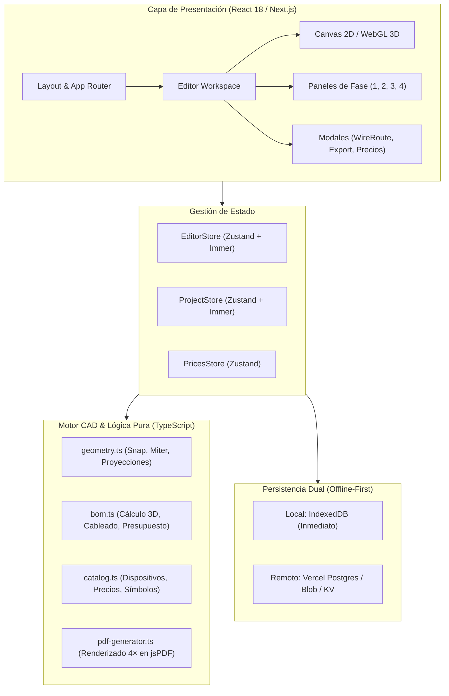

# GATC — Gestor de Análisis para Tendidos y Costos (v2.0)

[](https://nextjs.org/)
[](https://www.typescriptlang.org/)
[](https://tailwindcss.com/)
[](https://threejs.org/)
[](https://web.dev/progressive-web-apps/)
[](https://vitest.dev/)
[](https://playwright.dev/)

**GATC** es una plataforma CAD web profesional de ingeniería eléctrica residencial. Permite dibujar planos arquitectónicos en 2D, modelar en 3D con WebGL, diseñar circuitos y tendidos de tubería/cableado, y generar automáticamente cómputos métricos (BOM), presupuestos detallados y memorias descriptivas en formato PDF de alta resolución (4×).

---

## 🌟 Características Principales

### 1. Las 4 Fases del Flujo de Trabajo
* **Fase 1 — Obra Civil:**
  * Dibujo paramétrico de muros con cálculo automático de polígonos y uniones en inglete (*miter joins*).
  * Aberturas dinámicas: puertas batientes, ventanas y escaleras con acotación en metros.
  * Escalímetro virtual con reglas graduadas (*rulers*) y retícula (*blueprint grid*).
  * Gestión multinivel con *ghost rendering* (opacidad del 15% del nivel inferior).
* **Fase 2 — Diseño Eléctrico:**
  * Asignación de cajas de registro (hexagonales/octagonales en techo, rectangulares 4×2" en pared, cuadradas 4×4" para tableros).
  * Catálogo completo de simbología normalizada: luminarias, apagadores (sencillo, doble, triple, 3-way), tomacorrientes 120V/240V, tableros de distribución, etc.
  * Trazado de tubería conduit PVC con curvatura Bezier y alturas tridimensionales (bajadas/subidas de muro y techo).
  * Enrutador de conductores multihilo (Fase, Neutro, Tierra, Retornos) con calibres AWG y paleta de colores.
* **Fase 3 — Cotización (BOM Automático):**
  * Cómputo métrico exacto: metros lineales de cable (con holguras de +0.20m por terminal y +0.10m por caja de paso).
  * Redondeo de tubos de PVC al entero superior (`Math.ceil`).
  * Conteo automático de placas, tapas ciegas y accesorios.
  * Precios globales configurables con sobreescritura personalizada por proyecto y materiales custom.
* **Fase 4 — Memoria Descriptiva:**
  * Generación técnica automática de especificaciones arquitectónicas, cargas eléctricas estimadas y balance de circuitos por tablero.

### 2. Motor CAD 2D/3D
* **Renderer 2D en Canvas HTML5:** Ciclo de renderizado de alto rendimiento optimizado con `requestAnimationFrame` condicional.
* **Visor 3D Interactivo:** Construido con `@react-three/fiber` y `@react-three/drei`, con órbita 360°, corte de muros, renderizado tridimensional de tuberías y dispositivos.
* **Lazy Loading:** El visor 3D y el generador de PDF se cargan dinámicamente bajo demanda para optimizar el bundle inicial.

### 3. Persistencia Offline-First & PWA
* **Almacenamiento Dual (Adapter Pattern):** Guarda de inmediato en `IndexedDB` localmente (funciona 100% offline). Sincroniza en segundo plano con la API de Vercel PostgreSQL cuando hay red.
* **Service Worker v2:** Estrategias de caché avanzadas (CacheFirst para fuentes y CDNs, StaleWhileRevalidate para estáticos y NetworkFirst para navegación).
* **Instalable:** Manifiesto web con soporte para escritorio, tablets y móviles.

### 4. Seguridad y Resiliencia
* **React Error Boundaries:** Aislamiento de fallos en visor 3D, lienzo CAD y paneles. Fallback accesible con opción de reintentar y descargar reporte de diagnóstico.
* **Rate Limiting:** Control de saturación en endpoints API (60 req/min en CRUD, 10 req/min en compilación de PDF).
* **Cabeceras de Seguridad:** CSP estricto, HSTS, `X-Frame-Options: DENY`, `X-Content-Type-Options: nosniff`.
* **Accesibilidad (WCAG AA):** Soporte de navegación por teclado, `:focus-visible`, `aria-label` en todos los controles y respeto de `prefers-reduced-motion`.

---

## 🏗️ Arquitectura del Sistema



---

## 🚀 Inicio Rápido (Local Development)

### Requisitos Previos
* Node.js 18.17+ o 20+
* Gestor de paquetes: `npm`, `pnpm` o `yarn`

### 1. Clonar e Instalar Dependencias
```bash
git clone https://github.com/tu-usuario/gatc.git
cd gatc
npm install
```

### 2. Configurar Variables de Entorno
Copia el archivo de ejemplo y edita las claves necesarias:
```bash
cp .env.example .env.local
```

### 3. Ejecutar en Modo Desarrollo
```bash
npm run dev
```
Abre tu navegador en [http://localhost:3000](http://localhost:3000).

*(Opcional: Si deseas ejecutar el servidor estático ligero en PowerShell):*
```powershell
powershell -ExecutionPolicy Bypass -File server.ps1
```

---

## 🧪 Pruebas y Control de Calidad

```bash
# Ejecutar suite de pruebas unitarias del motor CAD (Vitest)
npm run test

# Pruebas con reporte de cobertura
npm run test:coverage

# Pruebas End-to-End (Playwright)
npm run test:e2e

# Ejecutar verificación automatizada completa de QA (Fase 10 & 11)
powershell -ExecutionPolicy Bypass -File tests/run-qa-tests.ps1
```

---

## 📦 Scripts Disponibles

| Comando | Descripción |
|---|---|
| `npm run dev` | Inicia el servidor de desarrollo de Next.js. |
| `npm run build` | Compila la aplicación para producción. |
| `npm run start` | Arranca el servidor de producción compilado. |
| `npm run test` | Ejecuta la suite de pruebas unitarias con Vitest. |
| `npm run test:e2e` | Ejecuta pruebas End-to-End con Playwright. |
| `npm run analyze` | Analiza el tamaño de los bundles con `@next/bundle-analyzer`. |
| `npm run lint` | Ejecuta ESLint sobre el código fuente. |
| `npm run format` | Da formato a todo el código con Prettier. |

---

## 🔄 Migración desde GATC v1.5

GATC v2.0 incluye un motor automático de detección y migración:
1. Al abrir la aplicación, el detector escanea las claves legacy de `localStorage` (`ecad_projects_index`, `ecad_data_*`, `ecad_global_prices`).
2. Muestra un banner y modal de migración asistida.
3. Transforma los esquemas planos de v1.5 a la estructura estricta v2.0 con validación Zod/JSON schema y versionado automático.

---

## 📄 Licencia

Este proyecto está bajo la Licencia MIT. Consulta el archivo `LICENSE` para más detalles.
